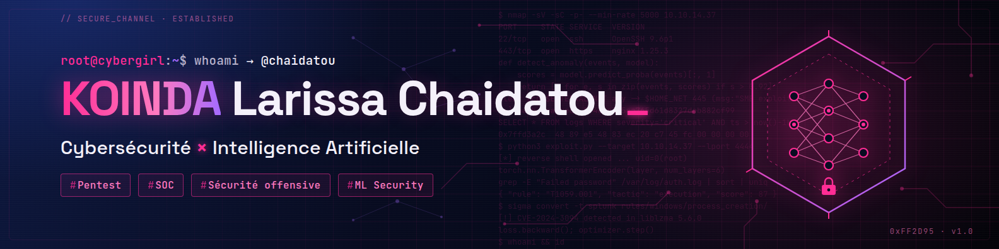

  

  <strong>Cybersécurité défensive & offensive — détection, supervision, durcissement</strong> 
  Étudiante en BTS Administration Réseaux et Sécurité · Responsable cybersécurité (freelance & startup)

  
  
  

---

Je construis et j'attaque des infrastructures pour mieux les défendre. Au quotidien, je mène des **tests d'intrusion**, des **audits de sécurité** et des **tests de charge**, et je monte des environnements de supervision qui transforment les logs en alertes exploitables.

Mon objectif : rejoindre une équipe qui travaille sur la protection des postes et des données — **EPP, EDR, XDR, DLP, SIEM**.

## 🛡️ En ce moment

**Mini-SOC automatisé** — je finalise un SOC complet assisté par IA : détection d'intrusion avec Suricata, centralisation des logs via Rsyslog, stockage SQLite, dashboard Grafana en temps réel et réponse automatique avec Fail2ban. Les scénarios d'attaque sont testés depuis Kali Linux.

## 🧰 Stack technique

**Systèmes**

**Détection & réponse**

**Supervision & données**

**Réseaux**

**Développement**

## Projets clés

| Projet | Description |
|---|---|
| **Mini-SOC automatisé**  Dépôt privé — démo sur demande | SOC automatisé assisté par IA. Suricata → Rsyslog → SQLite → Grafana, avec blocage automatique par Fail2ban. Dashboard temps réel, détection validée par des attaques simulées depuis Kali Linux. |
| **[Guide de sécurisation du code](https://github.com/chaidatou/security-by-design-guide)** | Sécurité dès la conception (*Security by Design*) pour applications et SaaS. Bonnes pratiques adaptables selon le framework et le langage. |
| **Labo Wazuh — SIEM/XDR** | Déploiement complet avec agents Windows et Linux, règles personnalisées, surveillance d'intégrité des fichiers (FIM) et attaque simulée Atomic Red Team corrélée à MITRE ATT&CK. |
| **Site vitrine cybersécurité** | Présentation de mes services : pentest, audit, tests de charge. *En construction.* |

## 📫 Contact

Ouverte aux opportunités en cybersécurité, aux missions d'audit et aux échanges techniques — contactez-moi sur LinkedIn.
